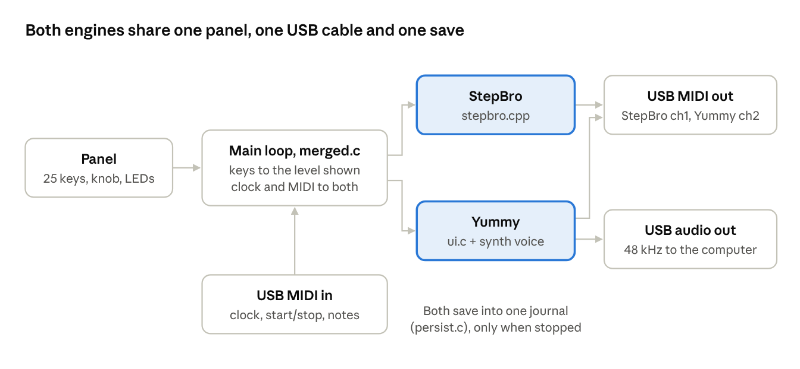

# Step Mother developer guide

Firmware 1.2.0 · November 2026

## Overview

Anyone with a computer, the source code and a USB cable can change the
Step Mother's firmware, write their own, and install it without opening the
enclosure. The firmware combines two engines:

- **StepBro**, a 32-voice MIDI step sequencer (channel 1 by default).
- **Yummy Gummy**, a 303-style synth with its own sequencer, played over USB
  audio (MIDI channel 2).

Shift + Bank + Play switches the panel between them, and both keep playing.

| Board | Chip | Clock | Firmware file | Installs through |
|---|---|---|---|---|
| Step Mother 1 | Teensy 4.1 (i.MX RT1062, one core) | 600 MHz | `.hex` | The Teensy bootloader |
| Step Mother 2 | RP2040 (two cores) | 200 MHz | `.uf2` | The RPI-RP2 drive (copy the file onto it) |

The two boards run the same firmware, built separately: the Teensy one in
`firmware/StepMother/`, the RP2040 one in `firmware/StepMother2/` (Pico SDK 2.1.1,
CMake, Arm GNU 13.2.Rel1; its README has the build commands). Most of this guide
is written for the Teensy; the RP2040 differences are in
[the RP2040 notes](#step-mother-2-rp2040).

This guide covers three paths:

1. **Changing the current firmware**: same code, your edits, built and checked
   the way releases are.
2. **Writing your own firmware**: anything that runs on a Teensy 4.1, using the
   hardware facts and the few rules in this guide.
3. **Installing it**: StepDaddy, or PJRC's own tools.

One rule matters more than any other: **keep the Glide + Function power-up
check** in any firmware you write. The enclosure hides the Teensy's program
button, so that key combination is the only way back into install mode without
opening the case.

## What you need

You need the source, a Linux or macOS computer (Windows works through WSL),
the ARM compiler and a USB cable. Nothing is soldered and the case stays
closed.

- **Source code:** this repository.
- **Hardware:** a Step Mother and a USB data cable. Some charging-only cables
  don't carry data.
- **Python 3.10 or later** for the build, check and updater scripts.

| Tool | Needed for | Version the releases use |
|---|---|---|
| ARM GNU toolchain (`arm-none-eabi-gcc`) | the firmware | 13.2.Rel1, from ARM's website |
| Teensyduino core and libraries | the firmware | 1.62.0, already in the repo (`firmware/StepMother/vendor/avr`) |
| A C compiler for your computer (gcc or clang) | the host tests | any current |

The repository's GitHub workflow (`.github/workflows/build.yml`) installs
exactly these tools on a clean machine and is the reference when a local setup
disagrees. Only the toolchain location is needed:

```sh
export ARM_TOOLCHAIN=~/arm-gnu-toolchain   # where the ARM toolchain was unpacked
```

## The code

| Path | What it is |
|---|---|
| `firmware/StepMother/` | The Step Mother 1 firmware: `src/`, `voice/`, `tests/`, `tools/`, plus `vendor/avr/` (Teensyduino 1.62.0) and `compat/` |
| `firmware/StepMother2/` | The Step Mother 2 (RP2040) firmware: `src/`, `voice/`, `tests/`, `tools/` |
| `updater/` | StepDaddy, the updater (`step_daddy.py`), and its tests |
| `.github/workflows/build.yml` | Builds, tests and publishes everything on every push |

Inside `firmware/StepMother/`:

| File | Role |
|---|---|
| `src/stepbro.cpp` | StepBro: keys, patterns, chains, MIDI out, LEDs |
| `src/ui.c` | Yummy: pages, knob, recording, automation, MIDI in and out |
| `voice/src/voice303.c`, `seq303.c` | Yummy's synth voice and step sequencer (portable C, also runs on your computer) |
| `voice/src/voice_profile.h` | Yummy's knob mappings (Cutoff, Env Mod, Decay) |
| `src/merged.c` | Routes keys to the level on screen, the Shift + Bank + Play switch, autosave |
| `src/persist.c` | The save journal shared by both engines |
| `src/firmware_version.h` | Version number, board name, and the tag StepDaddy reads |
| `src/audio.c` | Runs the synth into the USB audio buffer |
| `src/panel_teensy.cpp` | Key matrix, knob, LED driver |
| `src/main_teensy.cpp` | Start-up, the main loop, USB MIDI |
| `src/usb_name.c` | USB name "Step Mother" |
| `src/storage_teensy.cpp` | Where saves physically go: LittleFS files in program flash |
| `tests/` | Host tests that run both engines on your computer |

How the pieces fit at run time:

- Every millisecond the main loop scans the 25 keys and the knob.
- `merged.c` hands each key either to StepBro or to Yummy, depending on the
  level shown. Both engines run all the time.
- StepBro only sends MIDI. Yummy drives the synth voice, whose audio goes to the
  computer over USB.
- Both follow the computer's MIDI clock, and both engines' state goes into one
  save.



## Changing the current firmware

Edit, run the host tests, build, run the release check, then install. A change
is ready to share when all four steps pass. Pushing to GitHub, or opening a
pull request, runs the same steps for you.

1. **Edit** the code in `firmware/StepMother/`.
2. **Run the host tests.** They run StepBro and Yummy together on your
   computer, with simulated keys, knob and MIDI clock, in a few seconds:

   ```sh
   cd firmware/StepMother
   sh tests/run.sh > tests-final.log 2>&1   # 17 PASS lines expected
   ```

   Add a test for anything you change in `tests/integration.c`. Use the
   helpers there: `key()`, `tap()`, `clocks()`, `chord()` and the
   `test_bro_*` / `test_yummy_*` hooks.
3. **Build:**

   ```sh
   python3 tools/build_teensy.py > build-final.log 2>&1   # build/StepMother_firmware.hex
   ```

4. **Run the release check.** It needs the build and test output saved as
   `build-final.log` and `tests-final.log` in the board folder, as above:

   ```sh
   python3 tools/verify_teensy.py
   ```

5. **Install** with StepDaddy (see [Installing](#installing-firmware-on-the-device)).

What the release check refuses, and why:

| Check | Why it exists |
|---|---|
| One 48 kHz audio stream, five USB interfaces | Two streams made macOS list two Step Mothers |
| MIDI flushed only by the USB interrupt | A second flush from the main loop froze MIDI out |
| HEX checksums and flash boundaries | A corrupt or oversized image must never reach a board |
| USB name and version tag present | StepDaddy reads the tag; the name is what the computer shows |

### Versions

The version number is in `src/firmware_version.h`. Change it there and add a
`CHANGELOG.md` entry. StepDaddy shows this number and the release files are
named after it. When a change alters what the panel does, update the user
manuals (`docs/manuals/`) in the same release.

### Saves: don't break them

A board keeps its patterns across updates only if the new firmware reads the
old save. The save holds StepBro's data (16,456 bytes), then Yummy's (4,280
bytes), then 4 metadata bytes. A firmware whose sizes differ ignores the old
save, starts empty, and overwrites it at the next save.

- Don't add, remove or resize fields in StepBro's `SavedState` / `PatternSlot`
  or Yummy's `store_data_t`.
- Need a new setting? Reuse a field the firmware no longer uses, or give a bit
  a new meaning so old saves read sensibly. Removing a feature? Keep its field
  in the save, so the value is still there if the feature comes back. Check
  that the older version still reads the result.
- The host tests include a real save from an early version
  (`tests/legacy_v023_flash.bin`). If they still pass, older saves still load.
- Details: `firmware/StepMother/SAVE_COMPATIBILITY.md`.

### The automatic build

Every push to GitHub builds the firmware with the exact tools above, runs all
tests and checks, and builds StepDaddy for macOS and Windows. A push to `main`
also publishes the files to the `builds` branch, named with the version. A pull
request shows the same checks before merging.

### Voicing Yummy's filter

Yummy's filter is a four-pole zero-delay-feedback ladder (trapezoidal one-pole
stages with rational saturation; the feedback loop is solved within each
sample), so it stays in tune up to the top of its range without oversampling.
Its resonance, cutoff scaling, Env Mod and Decay curves and output level were
fitted to audio measurements of a reference 303 emulation.

The constants live in `voice/src/voice303.c` (filter and level, in the block
that computes `k_full` and `level_fit`) and `voice/src/voice_profile.h`
(Cutoff, Env Mod and Decay mappings). `voice/host/knob_behavior_test.c`
checks the mapping values: update it with any change there.

The delay stores its echoes at 24 kHz (1.2.0), with a 15-tap half-band filter
on the way in and on the way out; `tests/delay.c` checks echo time and level,
what the filter keeps out, fractional delays, stale history and the buffer
wrap.

Run the voice tests with `make -C voice test profile-test stress-test`.

## Writing your own firmware

Any program built for a Teensy 4.1 will run on the Step Mother. To use the
panel it only needs the facts below. It should also keep three things the
current firmware does, or the board becomes hard to update again.

### The panel

| Part | How it's wired | Teensy 4.1 pins |
|---|---|---|
| 25 keys, a 5 × 5 diode matrix | Rows driven low one at a time; columns read with pull-ups; a key is down when its column reads low | rows 0–4, columns 5–9 |
| Knob, a pot with end stops | Analog input; read it filtered, it's absolute | 14 (A0) |
| 20 LEDs | IS31FL3731 driver at I²C address 0x74, 400 kHz | SDA 18, SCL 19 (`Wire`) |
| USB | The Teensy's own USB socket | |

Key numbers are row × 5 + column:

| | col 0 | col 1 | col 2 | col 3 | col 4 |
|---|---|---|---|---|---|
| row 0 | Note | Pattern | Glide (Shift) | Accent (Mute) | not fitted |
| row 1 | pad 1 | pad 2 | pad 3 | pad 4 | not fitted |
| row 2 | pad 5 | pad 6 | pad 7 | pad 8 | Wave (Bank) |
| row 3 | pad 9 | pad 10 | pad 11 | pad 12 | Function (Clear) |
| row 4 | pad 13 | pad 14 | pad 15 | pad 16 | Play |

The names in brackets are what StepBro calls those keys.

LEDs: write brightness 0–255 to the driver's PWM register 0x24 + offset,
frame 1 selected. The offsets for pads 1–16, then Note, Pattern, Wave and
Play, are:

`48, 64, 80, 96, 112, 128, 0, 33, 65, 81, 97, 113, 129, 1, 17, 50, 16, 32, 49, 66`

Start-up needs care. Copy `led_attempt()` from `src/panel_teensy.cpp`. The
driver can clear registers as it wakes, and pads 7 and 14 stay dark unless its
enable registers are rewritten afterwards and read back.

The PCB, schematic and mechanical details are in the
[StepMother](https://github.com/AlexKokoschka/StepMother) repository.

### Keep these three

1. **The Glide + Function check at power-up.** Scan the keys first thing at
   power-up, before USB starts. If Glide (key 2) and Function (key 19) are both
   held, call `_reboot_Teensyduino_()` to enter the bootloader. Without it the
   only way back is the program button inside the case. Copy the start of
   `setup()` in `src/main_teensy.cpp`.
2. **A USB serial port.** It lets StepDaddy restart the board into install mode
   with no keys pressed. Build with a USB type that includes Serial (the
   firmware uses MIDI + Audio + Serial). A board without one can still be
   updated with Glide + Function.
3. **The version tag**, optional but useful: the text `SSFW|<board>|<version>|`
   somewhere in the image, kept by the linker. StepDaddy shows it, and refuses
   a file tagged for another board. Untagged files install too; StepDaddy shows
   their file name. See `src/firmware_version.h`.

### Starting points

- **Arduino IDE:** the simplest route is Teensyduino 1.62 (Board: Teensy 4.1;
  USB Type: one that includes Serial). Copy the key scan, the power-up check
  and the LED start-up from `panel_teensy.cpp` into the sketch. To show your
  own USB name, add a `usb_names` definition the way `src/usb_name.c` does.
- **This repo's build:** keep `tools/build_teensy.py`, which compiles
  everything in `src/` with the vendored Teensyduino subset.
- **Anything else** that runs on a Teensy 4.1, such as CircuitPython or Rust,
  also works. Just reproduce the power-up check, or keep a recovery plan that
  doesn't need the program button.

## Installing firmware on the device

StepDaddy installs any `.hex` you give it, with the case closed. Without
StepDaddy, PJRC's Teensy Loader does the same job.

### With StepDaddy

The downloaded StepDaddy installs the firmware it was built with. To install
your own file, run it from a terminal with `--firmware`:

```sh
/Volumes/StepDaddy/StepDaddy --firmware ~/Downloads/my_firmware.hex
```

On Windows, run `StepDaddy-Windows-<version>.exe` the same way. With Python
installed, `python3 updater/step_daddy.py` takes the same options.

If the running firmware has a USB serial port, StepDaddy restarts the board
into install mode itself. If not, it asks for Glide + Function while plugging
in. Either way the Teensy loader writes the file and restarts the board. Unplug
and replug the USB cable when StepDaddy says so.

### Without StepDaddy

Install PJRC's Teensy Loader (it comes with Teensyduino, or on its own from
pjrc.com). Open the `.hex` in it and turn on Auto. Then hold Glide + Function
while plugging in USB; the loader programs the board and restarts it.

### Step Mother 2 (RP2040)

StepDaddy detects an RP2040 that is already in update mode, copies the `.uf2`
onto its RPI-RP2 drive and the board restarts by itself. To get into update mode
hold Glide + Function while plugging in USB (Shift + Clear on older panels); a
brand-new board opens RPI-RP2 on its own. There is no USB serial port on this
firmware, so unlike the Teensy it cannot be restarted into update mode without
the keys. If StepDaddy can find neither board it asks which one you have. Use
`--product mother2` to skip detection. Without StepDaddy: copy
`StepMother2_firmware_v<version>.uf2` onto the RPI-RP2 drive yourself.

Build: `cd firmware/StepMother2`, set `PICO_SDK_PATH` and `PICO_TOOLCHAIN_PATH`
as in its README, then `cmake -S . -B build`, `cmake --build build`,
`sh tests/run.sh` and `python3 tools/verify_release.py`. Saves live in two flash
banks at 0x30000 and 0x38000 that an update leaves untouched; the linker stops
the build if the program grows into them.

### Brand-new boards

A new Teensy may not answer StepDaddy's no-keys restart, and the panel
combination only works once the firmware is on it. Install the first firmware
with the Teensy's own program button before the enclosure is closed. After
that, everything works with the case shut.

### If a firmware won't start, or has no way back

- **The board starts, but the panel combination doesn't work:** that firmware
  dropped the power-up check. Open the case and press the Teensy's program
  button with the Teensy Loader open, then install a firmware that keeps the
  check.
- **Nothing happens at all:** if the firmware runs the power-up check first
  thing, as the current one does, Glide + Function while plugging in still
  reaches install mode even when the rest of the firmware crashes.
- **No firmware can break the bootloader.** The Teensy's is on a separate chip,
  so a board can always be recovered with its button.
- **Saves:** installing never touches the save area. But a firmware that
  formats the LittleFS area erases it. Before handing out a firmware like that,
  warn people to back up anything they want to keep.

## Reference

### Limits that shape changes (1.2.0)

Teensy 4.1 (Step Mother 1). For the RP2040 see `firmware/StepMother2/README.md`:
about 12.5 KiB of static RAM margin, program and constants run from RAM.

| Resource | Step Mother 1 |
|---|---|
| RAM | 1 MB; DTCM gap about 210 KB |
| Largest RAM user | Yummy's delay line, 48 KB (about 1 s, stored at 24 kHz) |
| Program flash | 8 MB, about 120 KB used; saves in a 1 MB LittleFS area at its end |
| Saves | Files `/merged-v1-a.bin` and `/merged-v1-b.bin` |
| Audio | 48 kHz, 16-bit, stereo (dual mono), into the computer only |
| MIDI | USB MIDI, one cable; StepBro sends ch 1, Yummy sends and receives ch 2; plus a USB serial port |

Defaults: StepBro MIDI lead 4 ms, Yummy MIDI lead 8 ms, Yummy MIDI out off.

### Saving

- Both engines save into one journal (`src/persist.c`). It writes only while
  both sequencers are stopped and nothing has changed for 1.5 s. The Play light
  blinks while a save runs.
- Each save goes to the bank not in use and is committed last, with CRCs. A
  power cut mid-save leaves the previous save intact.
- Flash writes pause interrupts, so a save during playback would make the audio
  drop out. That's why saves wait for stop.

### Diagnostics

On the Yummy level, Function + Play sends a report as MIDI on channel 16: CPU
load (as a note: pitch = average %, velocity = peak %), audio underruns, late
USB packets, save counts, free stack, the longest main-loop pause (CC 82), what
is holding a save back (CC 83, as bits), how long ago the last key, knob or
MIDI activity was (CC 84), and the storage state (CC 85). Record it in a DAW
and decode the file with `tools/decode_diagnostics.py`. Function + Accent +
Play resets the peaks.

### Troubleshooting

| Symptom | Likely cause | Fix |
|---|---|---|
| Patterns gone after an update | Save layout sizes changed | Restore the old layout (see [Saves: don't break them](#saves-dont-break-them)) |
| StepDaddy can't restart the Step Mother | Firmware without USB serial, or a new Teensy | Glide + Function while plugging in; for a new Teensy, its program button |
| The board looks dead after an update | The host didn't keep up with the USB restarts | Unplug and replug the USB cable |
| Two devices with one name in Audio MIDI Setup | A Teensy build with both audio directions | Use the repo's build, which removes the unused direction |

More background: `firmware/StepMother/SAVE_COMPATIBILITY.md`,
`firmware/StepMother/README.md`, `firmware/StepMother/CHANGELOG.md` and
`updater/README.md`.
